# NEXAI 2026 Hackathon: Autonomous Dynamic Route Engine

**Track 4:** AI for Supply Chain & Logistics  
**Problem Statement 4.3:** Last-Mile Route Planner with Live Re-planning (VRPTW)  
**Team Name:** ByteForceDev  
**Deployment:** [Yet To Be Deployed](#)

---

## 1. Problem Statement and Solution Overview

### Problem Statement (PS 4.3)
Last-mile delivery operations are inherently vulnerable to dynamic operational disruptions:
* Unscheduled vehicle breakdowns leaving pending orders stranded mid-transit.
* High-priority mid-day rush orders requiring immediate insertion into active delivery routes.
* Customer cancellations and fluctuating delivery time windows.
* Unpredictable urban traffic bottlenecks delaying scheduled arrivals.

Under classical Vehicle Routing Problem with Time Windows (VRPTW) formulations, standard constraint-programming or MILP solvers (such as Google OR-Tools) require 10 to 60+ seconds to converge on dynamic replans. This creates unacceptable dispatch latency, blocks user interfaces, and lags behind rapidly evolving physical fleet positions.

### Our Solution
We engineered an enterprise-grade, real-time autonomous dynamic routing engine that solves dynamic disruption replanning in **under 5 milliseconds** (< 5ms), enabling continuous live synchronization between dispatchers and drivers:

1. **High-Performance C++ Core (`pyvroom`):** By integrating `pyvroom` (the Python binding to the high-performance C++ VROOM engine), we replace heavy MILP convergence with ultra-fast heuristic local search operators (regret-based insertion, tabu search, and 2-opt exchanges).
2. **State-Freezing & Temporal Route Slicing:** When a disruption occurs at virtual clock time $T_{\text{event}}$, past physical deliveries ($T \le T_{\text{event}}$) are permanently frozen as immutable. Completed customer deliveries cannot be un-delivered. Unvisited stops ($T > T_{\text{event}}$) are released back into an active pending pool.
3. **Mid-Route Kinematic Translation:** Each surviving vehicle's operational starting point is dynamically translated to the spatial coordinates of its *last completed delivery*, its available capacity is decremented by delivered load, and its operational horizon is bounded by $\max(T_{\text{event}}, T_{\text{completion}})$.
4. **Dynamic Fleet Re-allocation:** In the event of a vehicle breakdown, the disabled van is flagged as inactive, and its pending orders are dynamically re-routed across remaining active vehicles or awakened depot reserves. When rush orders are injected, the Euclidean distance matrix is dynamically expanded on the fly.
5. **Autonomous Dispatcher UI:** An interactive web dashboard built with a Light Mode Shadcn UI design system, custom Poppins typography, non-blocking `st.rerun()` event loops, continuous spatial interpolation of moving vans, live Plotly route maps, and real-time operational telemetry.

---

## 2. Architecture Diagram and Technology Stack

### System Flow Diagram

```mermaid
flowchart TD
    subgraph UI["Frontend Layer: Streamlit UI (Shadcn Light)"]
        A1["Interactive Dispatch Map (Plotly 2D)"]
        A2["Simulation Controls (Play / Pause / Speed)"]
        A3["Disruption Triggers (Breakdown, Rush Order, Cancellation)"]
        A4["Live Fleet KPIs & Driver Telemetry"]
    end

    subgraph State["Simulation & Event Management Layer"]
        B1["SimulationState (Event Manager)"]
        B2["Temporal Route Slicing (State-Freezing at T_event)"]
        B3["Vehicle Kinematic Translation (Mid-Route Positions & Capacity)"]
        B4["Dynamic Distance Matrix Expansion (O(N) Incremental Ingestion)"]
    end

    subgraph Engine["Optimization Layer: pyvroom (C++ Core)"]
        C1["vroom.Input & Matrix Buffer (np.uintc)"]
        C2["Integer Discretization Engine (Factor = 100)"]
        C3["C++ VROOM Heuristic Engine (Regret Insertion & Local Search)"]
        C4["Sub-5ms Re-optimized Solution Generation"]
    end

    A2 -->|"Tick / Step (st.rerun)"| B1
    A3 -->|"Trigger Event (T_event)"| B1
    B1 --> B2
    B2 --> B3
    B3 --> B4
    B4 --> C1
    C1 --> C2
    C2 --> C3
    C3 --> C4
    C4 -->|"Updated Routes & Timestamps"| B1
    B1 -->|"Real-Time Render Telemetry"| UI
```



### ASCII Architecture Flowchart

```
+-----------------------------------------------------------------------------------+
|                        STREAMLIT UI (SHADCN LIGHT DESIGN)                         |
|  - Poppins Typography               - Interactive Plotly 2D Spatial Map           |
|  - Non-blocking st.rerun() Loop      - Disruption Control Suite (Breakdown/Rush)   |
+------------------------------------------+----------------------------------------+
                                           |
                                           v
+-----------------------------------------------------------------------------------+
|                       SIMULATIONSTATE (EVENT MANAGER)                             |
|  - Temporal State-Freezing (T <= T_event: Frozen; T > T_event: Rescheduled)       |
|  - Vehicle Kinematic Translation (Mid-Route Node, Remaining Capacity)            |
|  - Dynamic Integer Distance Matrix Expansion (N x N -> (N+K) x (N+K))            |
|  - Kinematic Van Coordinate Interpolation: a = (T - D_A) / (A_B - D_A)            |
+------------------------------------------+----------------------------------------+
                                           |
                                           v
+-----------------------------------------------------------------------------------+
|                  PYVROOM (HIGH-PERFORMANCE C++ OPTIMIZATION ENGINE)               |
|  - Integer Discretization Factor = 100 (Coordinates, Windows, Service Times)      |
|  - Memory-aligned C-buffers (np.uintc / MSVC Buffer Format 'I')                   |
|  - Regret-based Heuristic Insertion & Fast Local Search Operators                 |
|  - Execution Time: < 5ms for 25-100 Nodes                                         |
+-----------------------------------------------------------------------------------+
```

### Technology Stack

| Component | Technology | Description |
|---|---|---|
| **Core Optimization Engine** | `pyvroom` (v1.15.2+) | Python bindings to VROOM C++ optimization engine for ultra-fast VRPTW solving |
| **Interactive UI Framework** | `Streamlit` (v1.30.0+) | Reactive dispatcher dashboard with native `st.rerun()` event-driven lifecycle |
| **Design System** | `Shadcn UI` (Light Mode) | Modern high-contrast monochrome design, custom zinc borders, and Poppins typography |
| **Spatial Map Visualization** | `Plotly` (v5.18.0+) | Real-time 2D Cartesian spatial dispatch map with continuous van coordinate interpolation |
| **Data Processing & Matrices** | `NumPy` & `Pandas` | Scaled integer Euclidean distance matrix generation and buffer alignment (`np.uintc`) |
| **Benchmark Ingestion** | Custom Solomon Parser | Scaled coordinate, service duration, demand, and time window ingestor |
| **Containerization** | `Docker` | Multi-stage lightweight container deployment for Hugging Face Spaces |

---

## 3. Setup and Execution Instructions

### Local Installation

1. **Clone the repository:**
   ```bash
   git clone https://github.com/ByteForceDev/NEXAI-2026-Hackathon.git
   cd NEXAI-2026-Hackathon
   ```

2. **Create and activate a virtual environment (recommended):**
   ```bash
   python -m venv venv
   # On Windows:
   .\venv\Scripts\activate
   # On Linux/macOS:
   source venv/bin/activate
   ```

3. **Install dependencies:**
   ```bash
   pip install -r requirements.txt
   ```

4. **Launch the interactive dispatcher application:**
   ```bash
   streamlit run app.py
   ```
   Open your browser at `http://localhost:8501`.

### Running Verification Tests

Execute the automated simulation, kinematic interpolation, and disruption test suite:
```bash
python tests/test_simulation_upgrade.py
```

### Docker Deployment

To build and run the application in a local Docker container:
```bash
docker build -t nexai-route-engine .
docker run -p 7860:7860 nexai-route-engine
```
Access the application at `http://localhost:7860`.

---

## 4. Deployment URL

* **Hugging Face Spaces:** [Yet To Be Deployed](#)

---

## 5. Dataset Attribution and Licence

### Dataset Attribution
This project evaluates routing performance using the globally recognized **Solomon VRPTW benchmark, SINTEF (1987)**:
* `data/C101.txt`: Standard 100-customer clustered Solomon instance.
* `data/C101_25.txt`: Standard 25-customer Solomon benchmark instance for rapid evaluation.

*Original Benchmark Reference:* Solomon, M. M. (1987). "Algorithms for the Vehicle Routing and Scheduling Problems with Time Window Constraints". *Operations Research*, 35(2), 254-265. SINTEF Applied Mathematics.

### Licence
This project is open-source and released under the **MIT Licence**.

---

## 6. Team Member Details

**Team ByteForceDev (VIT University):**

* **Raghav Mrituanjaya KS** (23MID0078, VIT University) 
* **Rachakonda Guru Karthikeya** (23MID0079, VIT University) 
* **Muppavaram Lohith** (23MID0104, VIT University) 

---

## 7. Development History & Audit Trail

For a complete architectural audit trail, see [DEV_LOG.md](./DEV_LOG.md).
